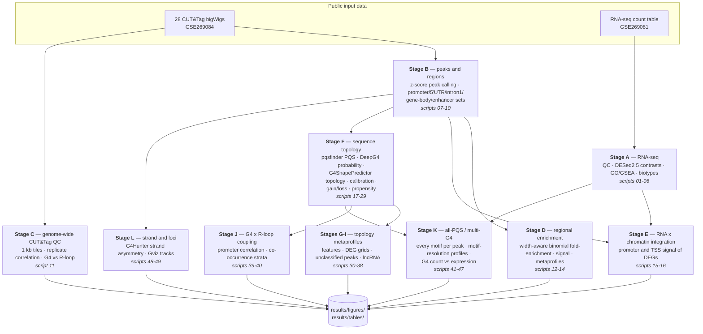
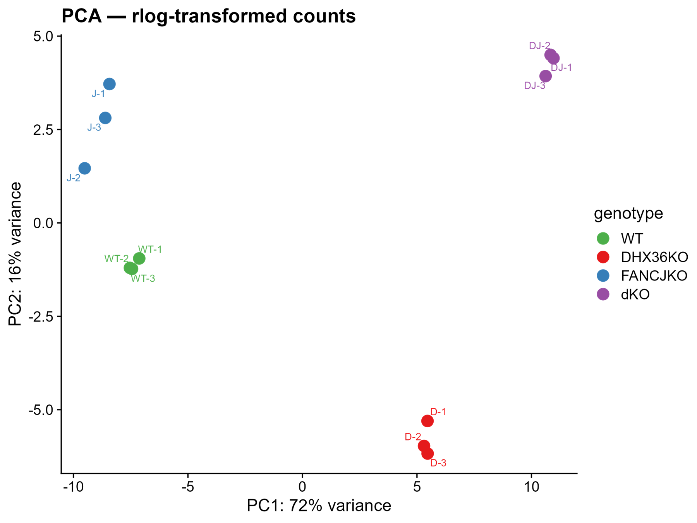
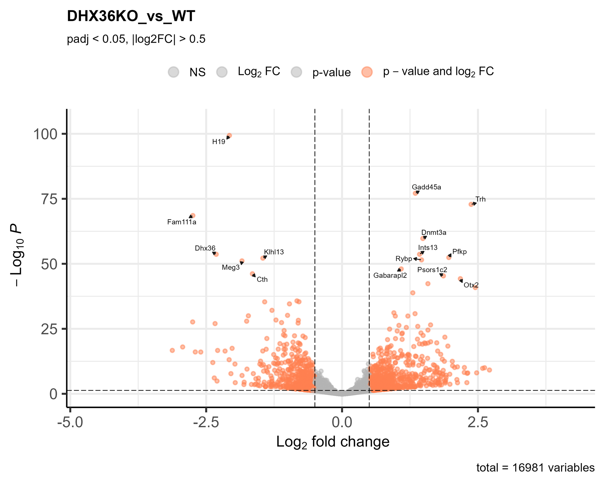
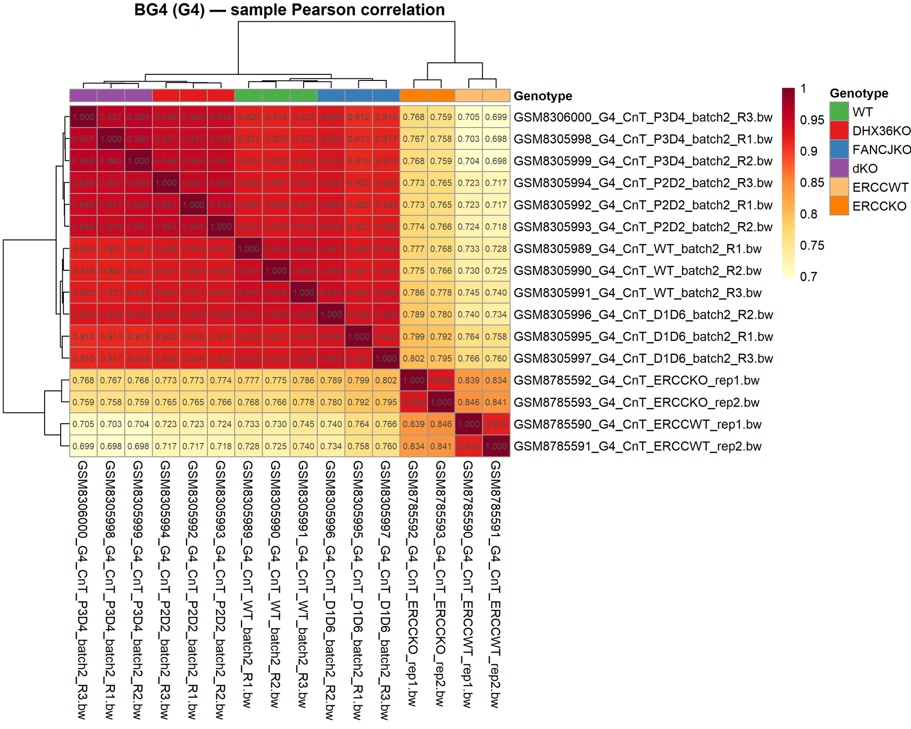
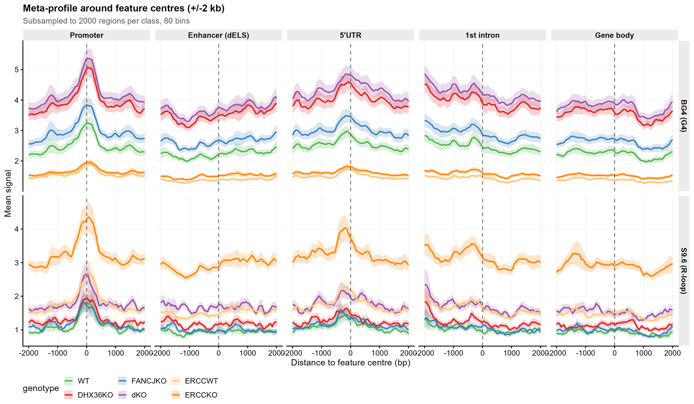
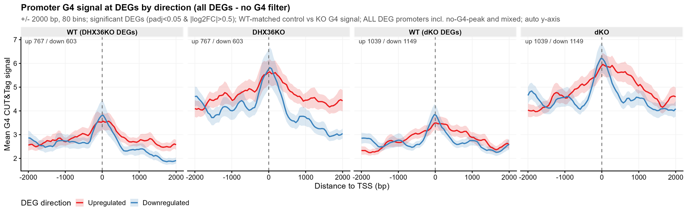
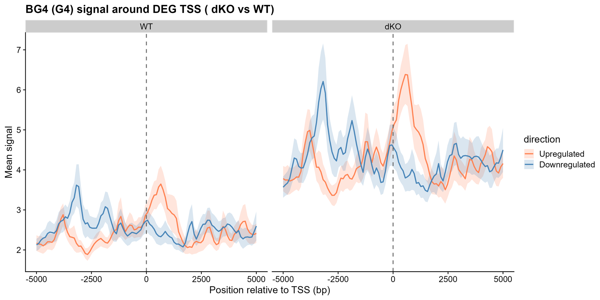
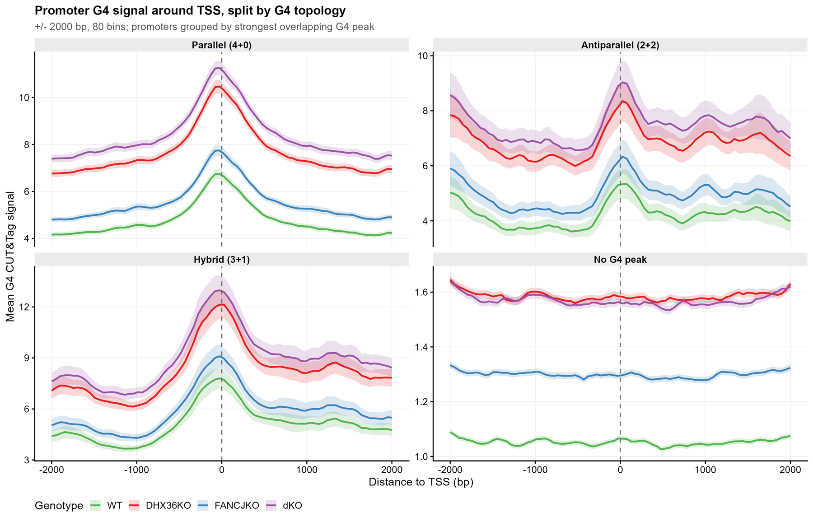
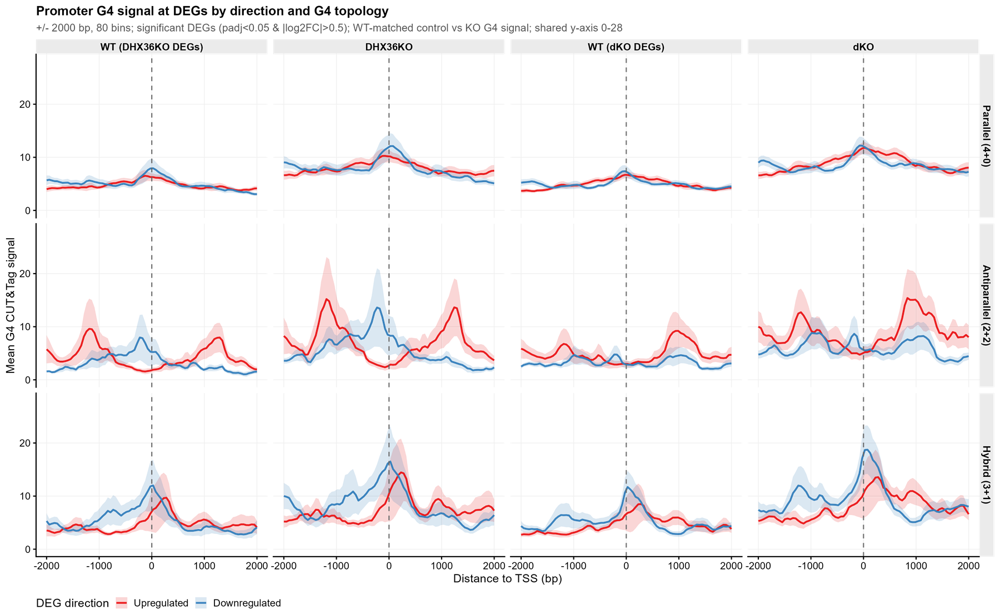
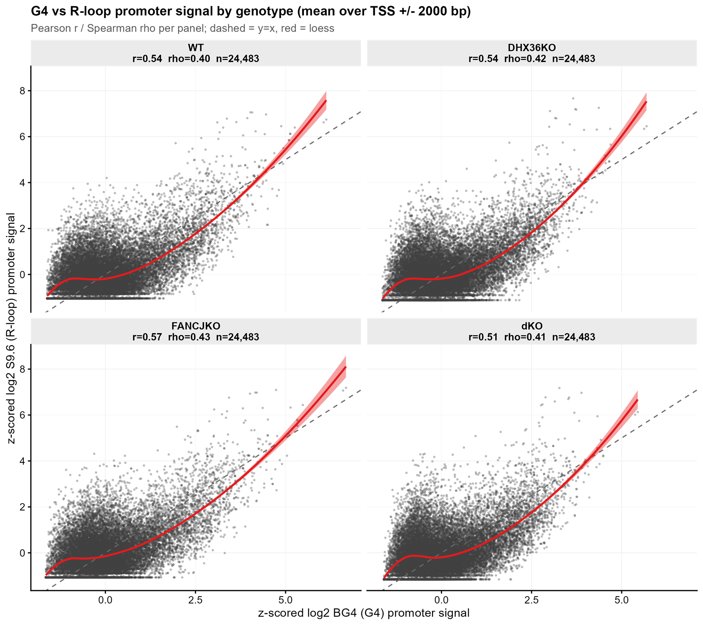

# G4_Promoter_Pipeline

**A reproducible Snakemake workflow for promoter-centric G-quadruplex and R-loop analysis of CUT&Tag and RNA-seq data.**

[](https://doi.org/10.5281/zenodo.21705743)
[](LICENSE)
[](https://snakemake.readthedocs.io)
[](https://www.r-project.org/)

This workflow takes public G-quadruplex (BG4) and R-loop (S9.6) CUT&Tag coverage tracks together
with an RNA-seq count table from wild-type, **DHX36** knockout, **FANCJ** knockout and
double-knockout mouse embryonic stem cells, and runs the complete analysis end to end: differential
expression, replicate-aware z-score peak calling, region-resolved enrichment, RNA × chromatin integration,
sequence-level G-quadruplex **topology** assignment, and promoter-focused metaprofiles down to
individual G4 motifs.

Everything derives from public data (GEO **GSE269081**, **GSE269082**, **GSE269084**). One command
fetches the inputs, one command reproduces every figure and table. Fifty-two numbered scripts, 54
Snakemake rules, one configuration file, no hidden state.

---

## Quickstart — from a fresh clone to every figure

Nothing here assumes you already have the data. A clone contains no input files; the download
scripts fetch them, and the workflow fetches the reference annotations itself.

```bash
git clone https://github.com/DJ-Goodall/G4_Promoter_Pipeline.git
cd G4_Promoter_Pipeline

# 1. software (once)
Rscript envs/install_r_packages.R              # CRAN + Bioconductor + DeepG4
conda create -n G4 -c conda-forge -c bioconda snakemake
conda env create -f envs/g4sp.yaml             # G4ShapePredictor python (pinned)
conda env create -f envs/tf_new.yaml           # optional: TensorFlow for DeepG4

# 2. data (~3.4 GB from GEO; resumable, size-verified)
scripts/download_data.sh                       # or .\scripts\download_data.ps1 on Windows

# 3. run
conda activate G4
snakemake -n                                   # dry run: should report 54 jobs, no missing inputs
snakemake --cores 4                            # full run
```

What the download step provides, and what the workflow provides on its own:

| Input | Where it comes from | Automatic? |
|---|---|---|
| 28 CUT&Tag bigWigs | GEO GSE269084, per-sample FTP | `download_data.*` |
| RNA-seq count table | GEO GSE269081 | `download_data.*` (unpacked for you) |
| G4ShapePredictor + its model pickles | GitHub clone into `external/` | `download_data.*` |
| GENCODE vM25 GTF | EBI FTP | yes — rule `gene_biotype`, with mirror fallbacks |
| mm10 RepeatMasker | UCSC | yes — rule `unclassified_peak_context`, 4 mirrors |
| ENCODE SCREEN cCREs | ENCODE, UCSC REST fallback | yes — rule `build_enhancers` |
| mm10 genome + transcript models | Bioconductor `BSgenome`/`TxDb` | `install_r_packages.R` |
| G4 topology control set | committed in `data/` | already present |
| Output directories | created on demand | yes |

Caveats worth stating plainly: you get the **same figures and tables**, and the numbers are
reproducible because every subsampling step has a fixed seed — but agreement to the last decimal
depends on matching package versions (R 4.5.1 / Bioconductor 3.21 here). DeepG4 is the one fragile
dependency and its failure costs a single figure. Peaks are recalled from the bigWigs rather than
read from a deposited peak file, so peaks are recomputed here rather than copied from a deposited
peak file. Note this is a *different* caller from the source paper, which used MACS3 (q < 0.05) with
consensus across all three replicates; the z-score caller here is more permissive and the counts are
not comparable to theirs.

## Contents

- [Biological system](#biological-system)
- [What the workflow does](#what-the-workflow-does)
- [Repository layout](#repository-layout)
- [Data availability](#data-availability)
- [Installation](#installation)
- [Running the workflow](#running-the-workflow)
- [Configuration](#configuration)
- [Outputs](#outputs)
- [Limitations](#limitations)
- [Selected results](#selected-results)
- [Reproducibility notes](#reproducibility-notes)
- [Citation](#citation)
- [License](#license)

---

## Biological system

| Property | Value |
|---|---|
| Cell type | Mouse embryonic stem cells (mESCs) |
| Reference genome | mm10 (GRCm38), chr1–19 + chrX |
| Annotation | `TxDb.Mmusculus.UCSC.mm10.knownGene`, `org.Mm.eg.db`, GENCODE vM25, ENCODE SCREEN V3 cCREs |
| Assays | G4 CUT&Tag (BG4 antibody, 3 replicates) · R-loop CUT&Tag (S9.6 antibody, 2 replicates) · RNA-seq (CEL-seq2, 3 replicates) |

**DHX36** (RHAU/G4R1) and **FANCJ** (BRIP1) are helicases that unwind G-quadruplexes. Removing them
individually and together tests how much of the steady-state G4 and R-loop landscape — especially at
promoters — depends on active resolution.

### Genotypes and the clone codes in the filenames

The GEO bigWig filenames use clone identifiers rather than genotype names. The workflow maps them in
[`scripts/_shared/helpers.R`](scripts/_shared/helpers.R):

| Genotype | Clone code in filename | Description |
|---|---|---|
| `WT` | `WT` | wild type |
| `DHX36KO` | `P2D2` | DHX36 knockout |
| `FANCJKO` | `D1D6` | FANCJ knockout |
| `dKO` | `P3D4` | DHX36 / FANCJ double knockout |
| `ERCCWT`, `ERCCKO` | `ERCCWT`, `ERCCKO` | ERCC1 wild-type / knockout CUT&Tag, used only as an independent control peak set (excluded from the main comparisons) |

RNA-seq count-table columns use a third convention (`WT`, `D`, `J`, `DJ`), mapped by
`rnaseq.sample_map` in [`config/config.yaml`](config/config.yaml).

---

## What the workflow does



### Stage detail

| Stage | Scripts | What happens | Figure themes |
|---|---|---|---|
| **A** RNA-seq | `01`–`06` | Library QC and PCA; DESeq2 across five contrasts with ashr shrinkage (padj < 0.05, \|log2FC\| > 0.5); GO:BP and GSEA (Hallmark + targeted DNA-repair/G4/R-loop pathways); gene-biotype resolved volcanoes | `01_qc` `02_deseq2` `03_enrichment` `16_volcano` |
| **B** Peaks + regions | `07`–`10` | 500 bp genome bins → per-replicate global z-score → bins passing z ≥ 2 in ≥ 2 replicates, merged across 500 bp gaps (`peak_calling.z_per_replicate`; set `false` for the v1.0 rule, which z-scored the replicate mean once and separately required non-zero coverage in ≥ 2 replicates); per-genotype and union peak sets; promoter (TSS ± 2 kb), 5′ UTR, first intron, gene body and ENCODE distal-ELS enhancer region sets | `04_peaks` |
| **C** Genome-wide QC | `11` | 1 kb tiles genome-wide (500 k subsampled), signal distributions, replicate correlation, G4-vs-R-loop scatter per genotype | `05_cuttag` |
| **D** Regional enrichment | `12`–`14` | Width-aware binomial fold enrichment of peaks in each region class, regional signal distributions, ±2 kb metaprofiles (80 bins), plus a full-peak validation metaprofile | `06_regional` |
| **E** Integration | `15`–`16` | Promoter (± 2 kb) CUT&Tag signal split by DEG direction; TSS ± 5 kb profiles (100 bins) for the top 500 up- and down-regulated genes per KO-vs-WT contrast | `07_integration` |
| **F** Topology core | `17`–`29` | 201 bp PQS-centred sequences (peak midpoint as fallback) + GC-matched and unmatched background; DeepG4 formation probability; pqsfinder PQS detection (score ≥ 20); G4ShapePredictor topology (parallel / antiparallel / hybrid / mixed) at 0.80 precision with an argmax sensitivity arm; loop-length heuristic reported alongside for comparison, never used to assign labels; literature-control calibration sweep; differential gain/loss (voom); propensity metrics; genomic-feature partition; R-loop coupling; promoter-G4 vs expression | `08_topology` `09_gain_loss` `10_metaprofiles` `11_propensity` `12_feature` `13_rloop` `14_expression` |
| **G** Topology metaprofiles | `30`–`34` | Topology-resolved BG4 profiles at promoters, 5′ UTRs, first introns and enhancers; DEG × topology grids; totals across features | `10_metaprofiles` |
| **H** Unclassified peaks | `35`–`37` | Peaks with no canonical PQS: signal profiles, sequence and repeat context (RepeatMasker), JASPAR motif enrichment | `15_unclassified` |
| **I** lncRNA | `38` | G4 occupancy at lncRNA TSSs (GENCODE vM25 biotypes), split by DEG status and gain/loss | `17_lncrna` |
| **J** G4 × R-loop | `39`–`40` | Promoter-level G4 vs R-loop signal correlation (background-median normalised, z-scored, hexbin) and co-occurrence strata with heatmaps | `18_g4_rloop_correlation` `19_g4_rloop_cooccurrence` |
| **K** All-PQS / multi-G4 | `41`–`47` | Every PQS per peak (overlapping registers collapsed), motif-resolution topology, motif density vs per-motif signal at TSSs, G4-count-per-promoter vs expression and KO response | `20_motif_distributions` `21_multiG4_expression` |
| **L** Strand + loci | `48`–`49` | G4Hunter net-G-richness strand asymmetry (±250/500 bp, binomial tests, BH-adjusted) and strand-split metaprofiles; Gviz multi-track locus figures | `22_strand` `23_gviz` |

One rule per numbered script, all wired into a single `rule all` — see [`Snakefile`](Snakefile).

---

## Repository layout

```
G4_Promoter_Pipeline/
├── Snakefile                     # 54 rules + rule all; one rule per numbered script
├── config/
│   ├── config.yaml               # every path, threshold and parameter
│   └── config.local.example.yaml # template for pointing at data you already have
├── scripts/
│   ├── _shared/helpers.R         # shared helper library (bigWig I/O, peak calling,
│   │                             #   profiles, genotype/clone mapping, plot themes)
│   ├── 01_*.R … 49_*.R           # analysis steps in DAG order
│   ├── 20_g4sp_topology.py       # G4ShapePredictor topology (g4sp conda env)
│   ├── 26a_*.py, 26b_*.py        # threshold sweep + literature-control benchmark
│   ├── 26d_*.R                   # the same benchmark for the loop-length heuristic
│   ├── download_data.ps1         # fetch inputs from GEO (Windows)
│   └── download_data.sh          # fetch inputs from GEO (Linux/macOS/WSL)
├── envs/
│   ├── install_r_packages.R      # installs the CRAN/Bioconductor/GitHub R stack
│   ├── g4sp.yaml                 # G4ShapePredictor python env (pinned sklearn 1.0.2)
│   ├── tf_new.yaml               # TensorFlow 2.13 for the DeepG4 rule (optional)
│   ├── r_g4.yaml                 # conda R env (Linux/WSL only — see Installation)
│   └── deepg4.yaml               # all-in-one DeepG4 env (Linux/WSL only)
├── data/
│   ├── geo_manifest.tsv          # the 28 CUT&Tag samples: accession, size, metadata
│   ├── known_topology_controls.tsv   # 10 literature-validated control G4s
│   ├── bigwig/                   # ← downloaded (git-ignored, ~3.4 GB)
│   └── rnaseq/                   # ← downloaded (git-ignored)
├── docs/
│   ├── figures/                  # showcase PNGs used in this README
│   └── audit-2026-08/            # the external audit, the point-by-point response
│                                 #   and the exact README/config deltas it produced
├── verify/                       # standalone checks that the audit corrections are
│                                 #   warranted; needs no bigWigs or cache (~1 min)
├── results/
│   ├── figures/NN_theme/         # generated: PDF + PNG at 300 dpi (git-ignored)
│   └── tables/                   # generated; the small summary tables are committed
├── cache/                        # generated intermediates: RDS, FASTA (git-ignored)
├── logs/NN_*.log                 # generated: one log per rule (git-ignored)
└── external/                     # G4ShapePredictor clone (git-ignored)
```

Committed vs generated: the repository tracks the workflow, the curated control table, the GEO
manifest, the small summary tables from the v1.0.0 run and the showcase figures. Inputs, caches,
logs, the full figure set and the large motif catalogues (up to 89 MB each) are reproduced by running
the pipeline.

---

## Data availability

All input data are public. Nothing in this repository needs restricted access.

| Dataset | Accession | What it provides |
|---|---|---|
| RNA-seq | [GSE269081](https://www.ncbi.nlm.nih.gov/geo/query/acc.cgi?acc=GSE269081) | `GSE269081_count_table.tsv` — 12 libraries × gene counts |
| G4 + R-loop CUT&Tag | [GSE269082](https://www.ncbi.nlm.nih.gov/geo/query/acc.cgi?acc=GSE269082) | subseries of the CUT&Tag samples |
| Series | [GSE269084](https://www.ncbi.nlm.nih.gov/geo/query/acc.cgi?acc=GSE269084) | all 28 bigWig coverage tracks |

Source study: *Sato et al.*, "RNA transcripts regulate G-quadruplex landscapes through G-loop
formation". Please cite it whenever you use these data.

### Sample inventory

The 28 tracks and their expected sizes are listed in [`data/geo_manifest.tsv`](data/geo_manifest.tsv):

| Assay | Antibody | Genotypes | Replicates | Files | Accessions |
|---|---|---|---|---|---|
| G4 CUT&Tag | BG4 | WT, DHX36KO, FANCJKO, dKO | 3 | 12 (~1.5 GB) | GSM8305989–GSM8306000 |
| R-loop CUT&Tag | S9.6 | WT, DHX36KO, FANCJKO, dKO | 2 | 8 (~125 MB) | GSM8306001–GSM8306008 |
| G4 + R-loop CUT&Tag | BG4, S9.6 | ERCCWT, ERCCKO (controls) | 2 | 8 (~1.3 GB) | GSM8785590–GSM8785597 |
| RNA-seq | — | WT, DHX36KO, FANCJKO, dKO | 3 | 1 count table | GSE269081 |

### Downloading

```powershell
# Windows PowerShell, from the repository root
.\scripts\download_data.ps1                 # 28 bigWigs + count table  (~3.4 GB)
.\scripts\download_data.ps1 -Refs           # ...plus GENCODE GTF and mm10 RepeatMasker
.\scripts\download_data.ps1 -WhatIf         # show the plan, download nothing
```

```bash
# Linux / macOS / WSL
scripts/download_data.sh                    # 28 bigWigs + count table
scripts/download_data.sh --refs             # ...plus reference annotations
scripts/download_data.sh --dry-run          # show the plan
```

Both scripts verify each file against the byte sizes in the manifest, skip files that are already
complete, resume interrupted transfers, and clone
[G4ShapePredictor](https://github.com/donn-liew/G4ShapePredictor) into `external/`. All 28 bigWigs
are needed for a full run — the ERCC tracks feed the control peak sets that `rule all` requires.

**Already have the tracks?** Don't copy them. Point the workflow at them with a local overlay —
`--configfile` merges recursively, so you only list the paths you want to change:

```bash
cp config/config.local.example.yaml config/config.local.yaml   # then edit the paths
snakemake --cores 4 --configfile config/config.local.yaml
```

(`config/config.local.yaml` is git-ignored. Plain `--config paths.bigwig_dir=…` does *not* work:
Snakemake's `--config` only accepts top-level keys.)

Alternatively, on Windows, link the directory in place (the junction is git-ignored):

```powershell
New-Item -ItemType Junction -Path data\bigwig -Target D:\path\to\existing\bigwigs
```

Reference annotations (GENCODE vM25 GTF, mm10 RepeatMasker, ENCODE cCREs) download themselves on
first use if absent; `-Refs`/`--refs` just front-loads the two large ones.

---

## Installation

The workflow was developed and run on **native Windows 11** with **system R 4.5.1**, **Snakemake
9.22** and three small conda environments. Bioconda publishes no Windows builds of the Bioconductor
genomics stack, so on Windows the R packages must come from your system R rather than from conda —
this is why the rules call `Rscript` directly and the workflow runs **without** `--use-conda`.

**1. R packages** (CRAN + Bioconductor + DeepG4 from GitHub):

```bash
Rscript envs/install_r_packages.R            # install what is missing
Rscript envs/install_r_packages.R --check    # report only
```

**2. Snakemake runner environment** (any recent Snakemake ≥ 7; 9.22 tested):

```bash
conda create -n G4 -c conda-forge -c bioconda snakemake
```

**3. G4ShapePredictor python environment** — the pins are load-bearing:

```bash
conda env create -f envs/g4sp.yaml           # python 3.9, scikit-learn 1.0.2, numpy<2
```

The published G4ShapePredictor model pickles were trained with scikit-learn 1.0.2, whose
decision-tree node dtype changed in 1.3. A newer scikit-learn cannot unpickle them and the topology
rule silently falls back to the loop-length heuristic. Do not relax these pins — see the comments in
[`envs/g4sp.yaml`](envs/g4sp.yaml).

**4. TensorFlow for DeepG4** (optional, one rule):

```bash
conda env create -f envs/tf_new.yaml       # python 3.8 + TF 2.13 + keras 2.13, via pip
```

TensorFlow comes from pip inside this env because conda-forge has no win-64 build of 2.13. The
DeepG4 R package lives in your system R library and reaches this env through `reticulate`
(`deepg4.reticulate_condaenv`, default `tf-new`). If DeepG4 or TensorFlow is unavailable, only the
ROC sanity check (script `22`, figure `08_topology/deepg4_roc`) is lost — the topology branch
completes on pqsfinder + G4ShapePredictor.

**On Linux/WSL** you can take the conda route for everything instead:

```bash
conda env create -f envs/r_g4.yaml
conda env create -f envs/deepg4.yaml
conda env create -f envs/g4sp.yaml
```

---

## Running the workflow

```bash
conda activate G4
snakemake -n                # dry run: resolves the DAG, checks inputs exist
snakemake --cores 4         # full run (do NOT pass --use-conda on Windows)
```

Useful invocations:

```bash
snakemake --cores 4 call_peaks                       # one rule and its dependencies
snakemake --cores 4 results/figures/08_topology/topology_counts.pdf   # one target
snakemake --dag | dot -Tsvg > dag.svg                # render the DAG
snakemake --cores 4 --rerun-incomplete               # after an interruption
```

**Smoke test.** Set `peak_subsample: 2000` in `config/config.yaml` to shrink the union peak set, run
the whole DAG in a fraction of the time, then set it back to `null` for the real run (and delete
`cache/` so full-size intermediates are rebuilt).

### Resources

| | |
|---|---|
| Disk | ~3.4 GB inputs (+170 MB reference annotations), ~0.4 GB `cache/`, ~0.5 GB `results/` |
| Memory | Peak calling and genome-wide binning dominate; genome tiles are subsampled (`genomewide.subsample: 500000`) and peak calling evicts per genotype to stay within a normal workstation |
| Time | Budget an overnight run from an empty `cache/` on 4 cores |

Slowest rules, all cached afterwards:

- `07_call_peaks` — reads all 28 bigWigs and bins the genome; the peak and region caches underpin
  every later stage.
- `41_extract_all_pqs` — pqsfinder across the full 147,843-peak union, ≈ 75 min; cached on union
  size, so downstream reruns are cheap.
- `19_deepg4_predict` — TensorFlow through reticulate; the most fragile dependency, and the only
  one whose failure costs a single figure rather than the branch.

Network-dependent rules cache after their first success: `09_build_enhancers` (ENCODE cCREs),
`05_gene_biotype` (GENCODE), `36_unclassified_peak_context` (RepeatMasker), `49_gviz_locus_tracks`
(UCSC ideogram — succeeds offline, simply without the ideogram track).

---

## Configuration

Everything tunable lives in [`config/config.yaml`](config/config.yaml); the scripts read nothing
else. The parameters most likely to matter:

| Key | Default | Meaning |
|---|---|---|
| `rnaseq.padj`, `rnaseq.lfc` | 0.05, 0.5 | DEG significance thresholds |
| `rnaseq.contrasts` | 5 pairs | DESeq2 contrasts, as `[numerator, denominator]` |
| `peak_calling.bin_size`, `z_thresh` | 500 bp, 2 | genome bin width and z-score peak cutoff |
| `peak_calling.min_replicates` | 2 | replicates a bin must pass in (3 G4 / 2 R-loop reps) |
| `regions.promoter_up/down` | 2000, 2000 | promoter window around the TSS |
| `pqsfinder.min_score` | 20 | minimum PQS score kept |
| `g4sp.precision` | 0.80 | G4ShapePredictor precision-optimised threshold |
| `metaprofile.half_width`, `n_bins` | 2000, 80 | metaprofile window and resolution |
| `differential.voom_padj`, `voom_lfc` | 0.1, 0.585 | gain/loss significance for peak signal |
| `genomewide.subsample` | 500000 | 1 kb tiles retained for genome-wide QC |
| `peak_subsample` | `null` | set to e.g. 2000 for a fast end-to-end smoke test |

Top-level keys can be overridden on the command line — `snakemake --cores 4 --config
peak_subsample=2000`. For nested keys use an overlay file
([`config/config.local.example.yaml`](config/config.local.example.yaml)) and
`--configfile`, which Snakemake merges recursively into the main config, or just edit
`config/config.yaml`.

---

## Outputs

```
results/figures/NN_theme/*.pdf   # publication vector figures
results/figures/NN_theme/*.png   # 300 dpi rasters (same content)
results/tables/*.{csv,tsv}       # every quantitative result
cache/*.rds                      # peaks, regions, motifs, profiles, DESeq2 objects
logs/NN_*.log                    # one log per rule, stdout + stderr
```

Twenty-three figure themes (`01_qc` … `23_gviz`) map onto the stage table above. The committed
`results/tables/` subset is the actual v1.0.0 output — the small summary tables plus the five DESeq2
contrast tables — so the numbers quoted below can be checked without running anything. Large derived
catalogues (`motif_catalog.csv`, `motif_g4sp_topology.csv`, `peak_catalog.csv`, …) are regenerated
by the workflow.

Key tables: `peak_summary.csv` (peak counts and widths per set), `region_fold_enrichment.tsv`,
`topology_composition.csv`, `sanity_metrics.csv`, `topology_precision_sweep.csv`,
`g4sp_control_benchmark.csv`, `strand_bias_summary.tsv`, `deseq2_results_<contrast>.tsv`,
`significant_DEG_union.tsv`, `go_enrichment_summary.tsv`.

---

## Limitations

> **Pre-run note.** The corrections described here were applied in response to the
> [2026-08-07 audit](docs/audit-2026-08/) and are documented in
> [`docs/audit-2026-08/REVIEW.md`](docs/audit-2026-08/REVIEW.md). Figures marked *expected* are
> derived from the committed v1.0 tables and the verification suite in [`verify/`](verify/); they
> are confirmed by the next full run. Everything else below is measured.

**Topology assignment is unresolved, and this version says so.** At the configured precision
G4ShapePredictor declines to classify 22.3 % of PQS-bearing peaks. v1.0 back-filled those with a
pqsfinder loop-length heuristic, which supplied 87 % of the reported hybrid stratum and 66 % of the
antiparallel stratum. Scored on the same 10 literature control quadruplexes, G4SP gets **8/10** and
the loop heuristic **2/10** — below the 33 % expected from guessing at a three-class problem
(`topology_control_benchmark_compare.csv`). The abstentions are therefore kept as their own `mixed`
stratum and no substitutions are made. Call provenance is reported in
`topology_source_composition.csv`, and `topology_sensitivity_precision.csv` reports the same
analysis under plain argmax, where there is no abstention at all.

**The two methods agree at chance level.** Cohen's κ = −0.0098 over the 101,638 peaks where both
give a definite call. κ is depressed here by very different marginals (G4SP 94.1 % parallel,
heuristic 34.4 %), so the marginal-free statement is the fairer one: of the heuristic's 41,122
hybrid calls only 741 (1.8 %) are also G4SP-hybrid; of its 25,539 antiparallel calls only 191
(0.7 %) agree.

**DeepG4 AUROC is 0.563** against GC-matched background, with Spearman ρ = 0.13 against peak
strength. DeepG4 is a classifier of formation propensity rather than an occupancy predictor, so the
weak ρ is expected — but an AUROC this close to 0.5 on the positive control is not. Either the GC
matching removes the signal (GC drives both DeepG4 score and BG4 occupancy), or a substantial
fraction of called peaks are not G4 sites. An unmatched background arm and a realised-vs-target GC
diagnostic (`background_gc_matching.csv`) are emitted to separate those two readings. The DeepG4
panels are diagnostic, not validation.

**The peak caller has no null.** A relative global z ≥ 2 on each sample's own signal cannot fail to
return peaks: the ERCC control tracks yield *more* peaks than the real samples (114,980 vs 107,276
for WT under the v1.0 rule). Peak counts are not comparable across genotypes either, since μ and σ
are recomputed per genotype — a global occupancy change is normalised away before thresholding.
Read the limma-voom differential signal on the union peak set (`23_gain_loss.R`) for the KO effect,
not `peak_summary.csv`. The pipeline has no IgG or input track; ERCC is the available substitute.

**The magnitude claim depends on someone else's spike-in scaling.** The WT < FANCJKO < DHX36KO ≈ dKO
ordering is read off *Drosophila*-spike-in-scaled bigWigs from Sato et al. This pipeline contains no
independent check on that scaling and no internal reference. The ERCC batch clustering at r ≈
0.70–0.80 while within-batch replicates reach r ≈ 0.94–0.98 shows batch effects of the relevant
magnitude exist in this assay.

**`peak_counts_per_region.tsv` and `region_fold_enrichment.tsv` count differently** under the same
region labels. The first is priority-exclusive (a peak is assigned to promoter > enhancer > 5′ UTR >
first intron > gene body and counted once): WT 5′ UTR = 878. The second uses non-exclusive overlap:
the same cell is 3,410. Neither is wrong; they answer different questions.

---

## Selected results

Nine figures from the v1.0.0 run, in [`docs/figures/`](docs/figures/). Each is produced by the
script named beneath it; the full set (23 themes, PDF + PNG) is regenerated by running the workflow.

### RNA-seq quality control and differential expression

 

*Left:* PCA of regularised counts — replicates cluster and the four genotypes separate
(`01_rnaseq_qc.R`). *Right:* DHX36KO vs WT, 16,981 genes tested, padj < 0.05 and |log2FC| > 0.5.
`Dhx36` itself is among the most significantly down-regulated genes, confirming the knockout;
the imprinted lncRNAs `H19` and `Meg3` drop sharply, while `Gadd45a`, `Trh`, `Dnmt3a` and `Otx2`
rise (`03_deseq2_plots.R`, table `deseq2_results_DHX36KO_vs_WT.tsv`).

### CUT&Tag replicates are highly reproducible



Pairwise Pearson correlation of BG4 coverage over 1 kb genome tiles, hierarchically clustered
(`11_genomewide_signal.R`). Replicates agree at **r ≈ 0.94–0.98** and cluster by genotype; across
genotypes r stays ≥ 0.91. The ERCC1 control samples, generated as a separate experimental batch,
form their own clade (r ≈ 0.70–0.80 against the main panel) — which is why they are used only as an
independent control peak set and excluded from the main comparisons.

### G4 occupancy peaks at promoters, 5′ UTRs and enhancers — and rises in the knockouts



Metaprofiles across all five region classes for both assays and all six genotypes
(`14_region_metaprofiles.R`). BG4 signal peaks sharply at promoters and 5′ UTRs, more weakly at
first introns, and is flat across gene bodies. The genotype ordering is consistent and
dose-dependent: **WT < FANCJKO < DHX36KO ≈ dKO** — losing the helicases raises steady-state G4
occupancy at promoters rather than redistributing it. R-loop (S9.6) profiles show the same TSS
architecture with a much weaker genotype effect.

Fold enrichment is quantified against a width-aware binomial null
(`12_peak_region_enrichment.R`, table `region_fold_enrichment.tsv`). The expectation for each peak
is the `reduce()`d region footprint dilated by the peak's own width — a 966 bp peak overlaps a
region set whenever its start falls within `region_width + peak_width − 1`, not merely within the
region. This is an analytic test, **not a permutation**: `regioneR::permTest` with
`circularRandomizeRegions` would be the gold standard but hangs on Windows, which is why the
binomial was substituted. BG4 peaks are enriched at promoters, distal enhancers and 5′ UTRs in
every genotype.

Two caveats. First, with n ≈ 100,000 peaks any deviation returns p ≈ 0 (36 of 60 rows underflow to
exactly zero), so the p-values are not doing work — read the fold values, not the stars. Second,
peaks are not independent Bernoulli draws; they cluster with mappability, GC and accessibility,
which the binomial cannot express.

The ERCC batch scores lower at promoters (BG4 fold 1.27–1.45 vs 1.92–2.12), but these tracks use
the **same BG4 antibody** and differ from the main panel by batch, so this is a batch comparison
rather than an antibody-specificity control. The pipeline has no IgG or input track and cannot
establish antibody specificity. Note also that the ERCC **R-loop** tracks score *higher* at
promoters (1.31–1.37) than the real S9.6 WT track (0.99), which is the opposite of what a
specificity argument would predict.

### Promoter G4 signal gains in the knockouts, and tracks with expression change



All significant DEG promoters, with no G4 filter applied, comparing each KO against the
WT-matched control set (`31_deg_promoter_metaprofiles.R`). Mean BG4 signal at the TSS rises from
~3.8 in WT to ~5.8 in DHX36KO and ~6.2 in dKO — a clear gain of promoter G4 occupancy on the same
gene sets (767 up / 603 down for DHX36KO; 1,039 up / 1,149 down for dKO).



The same effect over a wider ±5 kb window for the top 500 up- and down-regulated genes
(`16_integration_tss_profiles.R`). Signal roughly doubles in the double knockout, and the
directional split inverts across the TSS: up-regulated genes carry the higher peak downstream,
down-regulated genes upstream.

### Topology-resolved promoter metaprofiles



Promoters grouped by the topology of their strongest overlapping G4 peak
(`24_tss_metaprofiles.R`). All three quadruplex classes give a sharp TSS peak — highest for
**hybrid (3+1)**, then parallel (4+0), then antiparallel (2+2) — while promoters with no called G4
peak are flat, an internal negative control. The helicase-loss ordering
(WT < FANCJKO < DHX36KO ≈ dKO) holds within every topology class, so the KO effect is on occupancy
magnitude rather than on which topology is present. Composition itself barely moves across
genotypes: 72.9 % parallel, 10.0 % hybrid, 7.9 % antiparallel and 9.1 % without a canonical PQS in
WT (`topology_composition.csv`).



The DEG analysis split by topology on a shared axis (`31_deg_promoter_metaprofiles.R`). Parallel and
hybrid promoters keep a defined TSS peak that gains in the knockouts, with down-regulated genes
reaching the higher maximum; antiparallel promoters instead show flanking rather than TSS-centred
signal, and are the noisiest class — consistent with their being the smallest topology group.

### G4 and R-loop occupancy are coupled at high-signal promoters



Mean G4 versus R-loop signal over TSS ± 2 kb for 24,483 promoters per genotype, background-median
normalised and z-scored (`39_g4_rloop_promoter_correlation.R`). Correlation is moderate and stable
across genotypes (Pearson r = 0.51–0.57, Spearman ρ = 0.40–0.43), but the loess fit is markedly
non-linear: R-loop signal is flat across low-G4 promoters and rises steeply above roughly 2.5 z.
Coupling is therefore a property of the strongly G4-occupied promoters rather than a genome-wide
proportionality, and helicase loss does not change that relationship.

### Promoter G4 content does not predict which genes respond to helicase loss

Neither the number of G4s at a promoter nor their assigned topology predicts which genes change
expression in the knockouts (`29_promoter_g4_expression.R`, `47_multiG4_promoter_expression.R`).
The headline test — parallel-G4 promoters vs no-G4 promoters — is non-significant in all three KOs
(Wilcoxon p = 0.169 / 0.179 / 0.779), with median |LFC| differences of ~0.001. G4 count per
promoter correlates with baseline expression at ρ = 0.022 (p = 0.008, significant only because
n ≈ 20,000) and with |LFC| not at all (Kruskal p = 0.26–0.58). The one nominally significant result
(FANCJKO Kruskal p = 0.044) sits on a median difference of 0.001 and would not survive correction
across the three tests.

This is a real result, not a failed one. Steady-state G4 occupancy at a promoter, measured in bulk
chromatin, is **not sufficient** to predict transcriptional consequence. Occupancy conflates
formation with persistence; position relative to the TSS is collapsed into presence/absence; and
strand is not resolved. Separating those requires a system where topology, position and strand are
defined on the template rather than inferred from sequence — which is precisely what the κ ≈ 0 and
2/10 control results in [Limitations](#limitations) say cannot currently be done computationally.

---

## Reproducibility notes

- **Full rebuild.** Delete `cache/` and rerun: every intermediate is derived from the bigWigs and the
  count table, so the workflow reproduces from public data alone.
- **Determinism.** Every subsampling step has an explicit seed in `config/config.yaml`
  (`subsample_seed`, `region_signal_seed`, `profile_seed`, `background_seed`, `strand.seed`).
  Results are reproducible given the same package versions; `sessionInfo()` is recorded in the logs.
- **Graceful degradation.** DeepG4/TensorFlow failure costs only the rule-22 ROC. Running offline
  costs only the Gviz ideogram track. A wrong scikit-learn version in the `g4sp` env makes the
  topology rule fall back to the loop-length heuristic — check `logs/20_g4sp_topology.log` if
  topology proportions look unexpected.
- **Provenance.** One rule per numbered script, one log per rule, and the header of every script
  documents its inputs, outputs and the parameters it consumes.

---

## Citation

If this workflow contributes to your work, please cite both the software and the source data.

```bibtex
@software{goodall_g4_promoter_pipeline,
  author    = {Goodall, Daniel J. and Sato, K. and Knipscheer, P.},
  title     = {{G4\_Promoter\_Pipeline}: a Snakemake workflow for promoter-centric
               G-quadruplex and R-loop analysis of CUT\&Tag and RNA-seq data},
  version   = {1.0.0},
  year      = {2026},
  publisher = {Zenodo},
  doi       = {10.5281/zenodo.21705743},
  url       = {https://doi.org/10.5281/zenodo.21705743}
}
```

Two DOIs exist. **`10.5281/zenodo.21705743` is the concept DOI** — it always resolves to the newest
release and is the one to cite. `10.5281/zenodo.21705744` pins v1.0.0 specifically, for when an
analysis must reference the exact code that produced it.

Machine-readable metadata: [`CITATION.cff`](CITATION.cff) and [`.zenodo.json`](.zenodo.json).
Data: GEO GSE269081 / GSE269082 / GSE269084 (*Sato et al.*). Third-party tools and reference data,
with their licences and citations: [`THIRD_PARTY.md`](THIRD_PARTY.md).

---

## License

Code — [MIT](LICENSE). Committed figures and derived tables — CC-BY-4.0, see
[`LICENSE-DATA.md`](LICENSE-DATA.md). Third-party software and reference data are not
redistributed here and keep their own terms ([`THIRD_PARTY.md`](THIRD_PARTY.md)).

## Acknowledgements

Built on [DeepG4](https://github.com/raphaelmourad/DeepG4),
[G4ShapePredictor](https://github.com/donn-liew/G4ShapePredictor),
[pqsfinder](https://bioconductor.org/packages/pqsfinder/), the Bioconductor genomics stack, and
public reference data from GENCODE, ENCODE SCREEN and the UCSC Genome Browser.
